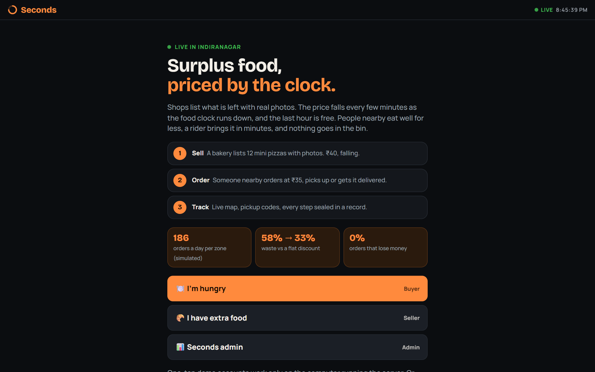
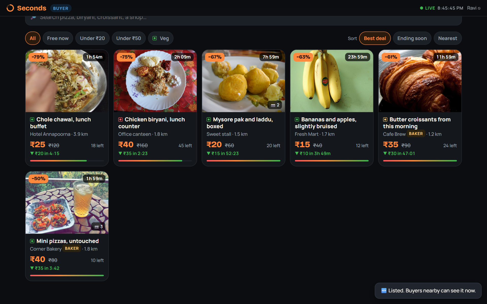
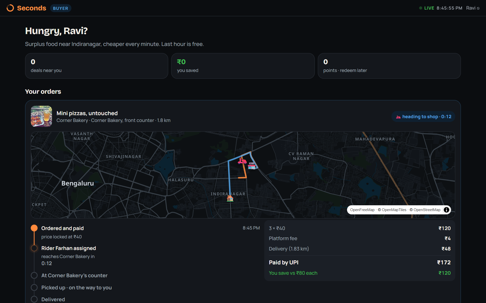
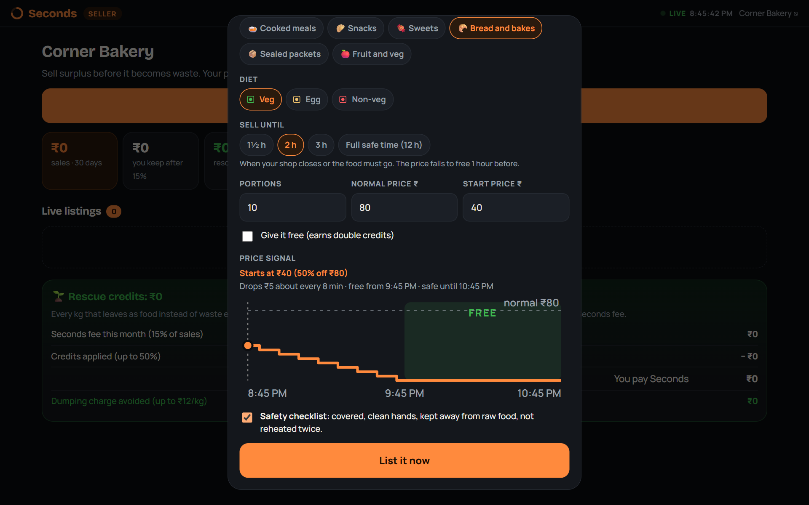
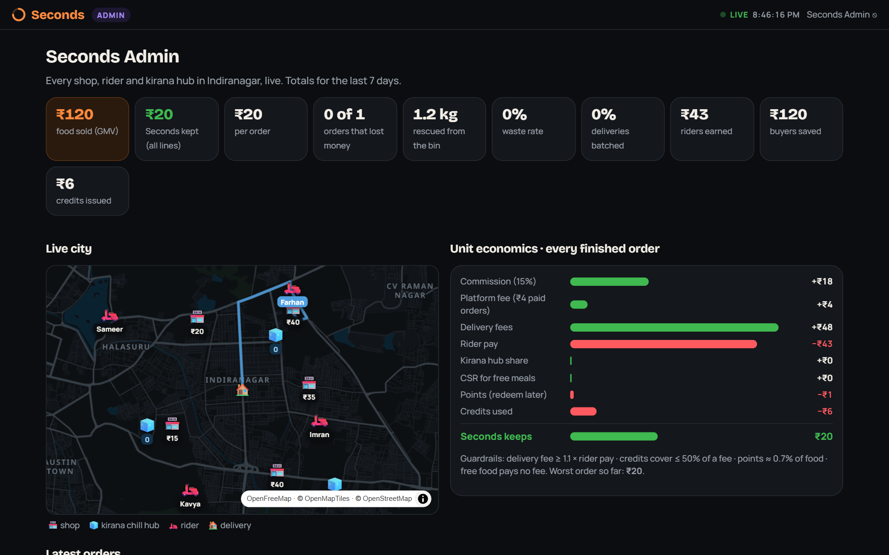
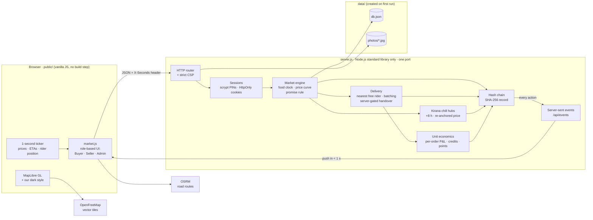
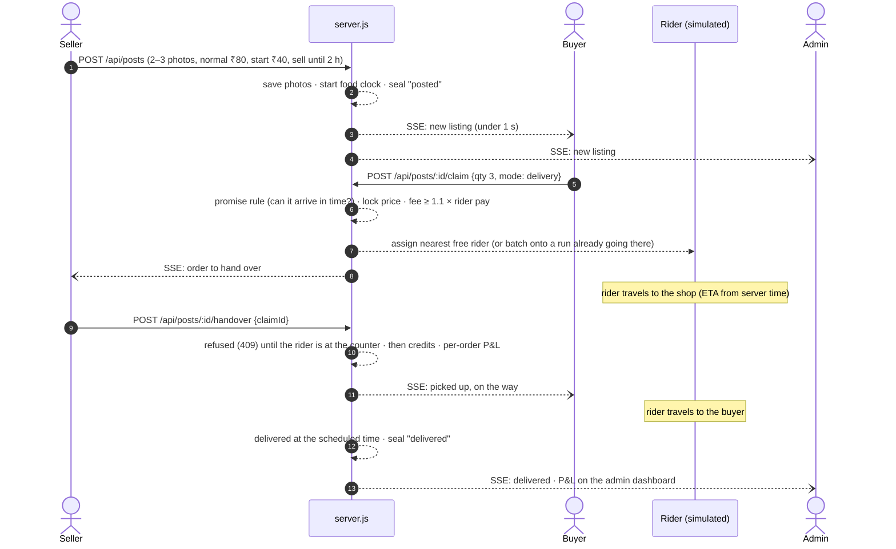
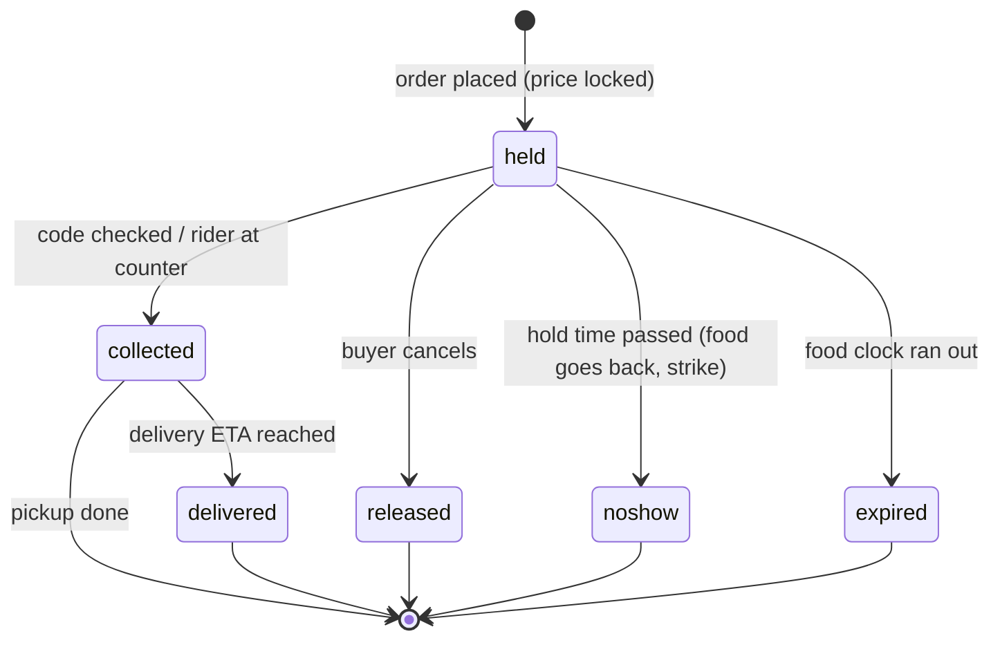
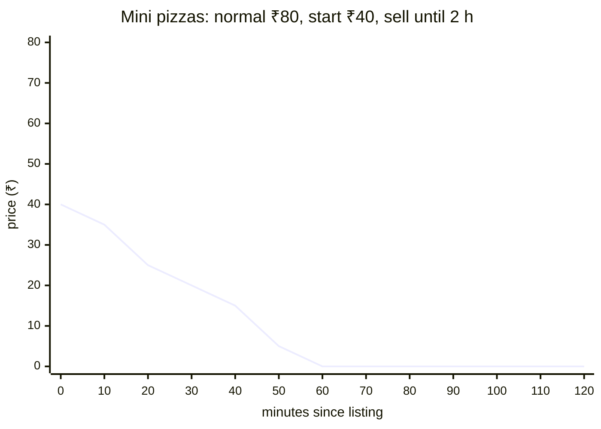
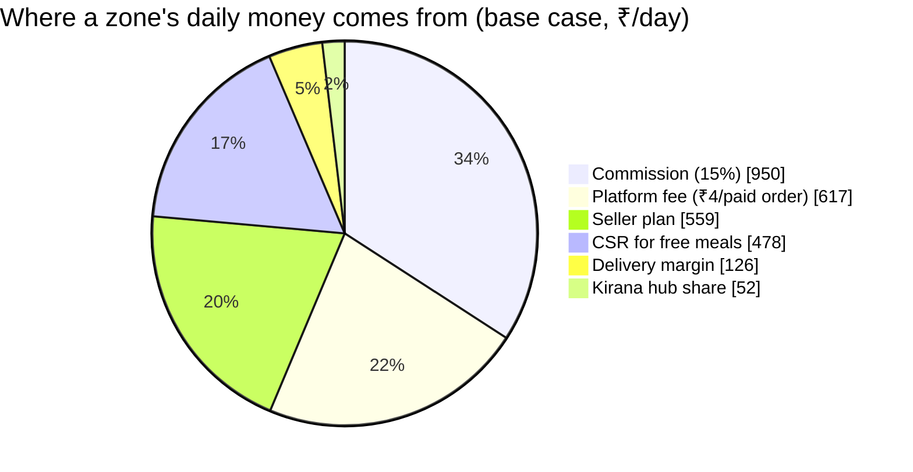

<div align="center">



# Seconds

### Surplus food, priced by the clock.

A live market where bakeries, kitchens and shops sell food that is about to become waste.<br>
The price falls with the food's safety clock, the last hour is free, a rider brings it in minutes,<br>
and every order is checked so it can never lose money.


**Team axon** · Rewired 2026 · Masters' Union · Road to Milky Way, Bangalore · Theme: *The Invisible City*

</div>

---

## The problem in one line

Bengaluru throws away about **296 tonnes of food a day** while thousands nearby skip meals. The food and the hunger are a few kilometres apart. **What breaks is time:** cooked food is safe for a couple of hours, and coordination over WhatsApp is too slow. Sources are in [SOURCES.md](SOURCES.md).

## What Seconds does

| | |
|---|---|
| 🥐 **Seller** (bakery, kitchen, shop) | Lists surplus with **2–3 real photos** (enforced). Sets the normal price; the start price defaults to half. The price then **drops ₹5 a step along the food clock** and is **free in the last hour**. Hands over with a one-time code, or to a rider. Earns **rescue credits**. |
| 🍽️ **Buyer** | Searches what's near, sees photos, the live price, the % off and a **BUY / WAIT signal**. Orders for **pickup** (4-digit code) or **delivery** (nearest free rider, live map, ETA). Earns points to redeem later. |
| 📊 **Admin** | The whole city, live: shops with current prices, **kirana chill hubs**, riders on the move, a **profit and loss for every order**, signals per shop, the stress test, and a tamper-evident record. |

Everything is **live**: whatever one person does reaches every other screen in under a second.

<table>
<tr>
<td width="50%"><br><sub><b>Buyer:</b> live prices falling, % off, next drop countdown, food clock</sub></td>
<td width="50%"><br><sub><b>Tracking:</b> rider on real road routes, step-by-step ETA, itemised bill</sub></td>
</tr>
<tr>
<td><br><sub><b>Seller:</b> 2–3 photos required, pricing engine preview</sub></td>
<td><br><sub><b>Admin:</b> per-order P&amp;L, nothing below zero</sub></td>
</tr>
</table>

## Run it

Needs **Node.js 18+**. Nothing to install.

```bash
git clone https://github.com/dhruva137/seconds-axon.git
cd seconds-axon
node server.js
```

Open **http://localhost:4173**.

- **Sign in:** use a phone number and 6-digit PIN, or **Join** to create an account (buyer or seller).
- **Demo accounts:** on the computer running the server, one tap signs you in as the **Buyer** (Ravi), the **Seller** (Corner Bakery) or the **Admin**. Their phone numbers and PIN are in `data/seed.json`, created on first run.
- **Sign out:** top right.
- **Sample listings:** demo mode places sample listings, kirana hubs and riders around Indiranagar. `SECONDS_DEMO=0 node server.js` turns this off.
- **Reset:** stop the server and delete `data/`.

```bash
npm test          # 103 end-to-end checks against a throwaway data folder
npm run stress    # Monte Carlo stress test, writes econ/results.json + ECONOMICS.md
```

A two-minute walkthrough: list → order with delivery → rider handover → admin P&amp;L.

1. **Seller:** tap *I have extra food*, then **Sell surplus food**, add photos, set the normal price, choose *Sell until 2 h*, and list it.
2. **Sign out**, then tap *I'm hungry*: search *pizza*, open it, choose **Deliver**, and **Order**.
3. **Sign out**, sign in as the seller again, and press **Hand to rider** when it unlocks (about 20 s in demo mode).
4. **Sign out**, then sign in as **Seconds admin**: see the live map, the order's P&amp;L and the stress test.

---

## Architecture



**Design choices**
- **One process, zero dependencies.** `server.js` uses only `http`, `fs`, `path` and `crypto`. Nothing to install, nothing to break.
- **The server is the source of truth for time.** Prices, safety clocks, rider arrival and delivery are computed from server timestamps. The browser only animates them.
- **Push, not poll.** One SSE stream per tab; each record in the chain is announced, and every screen refreshes within a second.
- **Atomic persistence.** The database is written to a temp file, then renamed, so a crash never leaves half a file.

## An order, end to end



### Order states



## The pricing engine: a Dutch auction on a clock

A listing starts at the seller's price and steps down in ₹5 increments until one hour before its safe time ends; from then on it is free:

```
price(t) = round( start × (freeAt − t) / (freeAt − listedAt) / 5 ) × 5      // 0 once t ≥ freeAt
freeAt   = safeUntil − 60 min
```



Eager buyers pay more early, price-sensitive buyers wait, and everyone else eats free. The buyer sees **BUY NOW / WAIT / FREE** from the next drop and the stock left. In simulation this sells **63% more orders than a flat 50% discount** and cuts waste from **58% to 33%**.

## Safety and trust

- **Safety clock per food type:** cooked meals 2 h 30 from cooking (the strict end of FSSAI's 4–6 h room-temperature window), snacks 4 h, sweets 8 h, bread 12 h, sealed packets 18 h, fruit 24 h. No handover after the clock runs out; the server refuses it.
- **Promise rule:** an order is refused unless the trip (18 km/h + 5 min) plus a 10-minute margin fits inside the food's remaining safe time.
- **Photos are mandatory:** 2–3 per listing, shrunk to JPEG in the browser, size-checked on the server.
- **Handover:** a one-time 4-digit code for pickups, rate-limited. For delivery, the server unlocks handover only once the rider has reached the counter.
- **Tamper-evident record:** every action is appended with the SHA-256 of the entry before it. Edit any past entry and the chain breaks; the admin view checks it.
- **Privacy:** strangers see a pin rounded to about 250 m. The exact address and code appear only to the buyer. Phone numbers are never shown.
- **Sessions:** 6-digit PINs hashed with scrypt, HttpOnly SameSite=Strict cookies, lockout after 5 wrong PINs, a required `X-Seconds` header on every POST, a strict Content-Security-Policy, and request size limits.
- **Fair use:** two open orders per buyer, five open listings per seller; three no-shows pause ordering for a day.

## Economics: nobody loses, the business holds

| Who | Gets |
|---|---|
| Seller | Cash for food that was going in the bin · up to ₹12/kg dumping charge avoided · rescue credits (₹3/kg sold, ₹6/kg free, +₹2/kg bakers) |
| Buyer | 50–100% off real food · free in the last hour · 1 point per ₹10 |
| Rider | ₹30 + ₹7/km, +₹15 per batched order · about ₹100/hour on the road |
| Kirana hub | ₹2 for every portion sold from its fridge |
| Seconds | 15% commission + ₹4 platform fee (paid orders only) + delivery margin + hub share + CSR for free meals + seller plan |

**The guardrails that keep every order at or above zero:**

```
delivery fee = max(₹35, ₹27 + ₹8·km, 1.1 × rider pay)       → delivery never runs at a loss
credits      ≤ 50% of a seller's fee, never cash            → credits can't outspend revenue
points       ≈ 0.7% of food value                           → loyalty is bounded
free food    pays no fee (a CSR sponsor or nothing)         → giving away is never charged
```



**Monte Carlo stress test** (`econ/stress.js`). It simulates one city zone minute by minute: Poisson listings and buyers, Beta-distributed willingness to pay, riders, no-shows and hubs. Each scenario runs for 400 days.

| Scenario | Orders/day | Profit/day after fixed costs | Profitable days | Loss-making orders | Waste |
|---|---|---|---|---|---|
| **Base case** | 186 | **₹614** | **98%** | **0%** | 33% |
| Marketplace only (no fee, CSR or plan) | 183 | −₹1,054 | 0% | 0% | 33% |
| Rain (deliveries ×1.8, rider pay ×1.3) | 172 | ₹599 | 99% | 0% | 37% |
| Rain **without** the fee floor | 175 | ₹176 | 75% | **10%** | 35% |
| Event night (2.5× late surplus) | 209 | ₹881 | 100% | 0% | 46% |
| No chill hubs | 169 | ₹437 | 96% | 0% | 39% |
| Flat 50% off (no falling price) | 114 | ₹556 | 98% | 0% | 58% |
| Demand halves | 109 | −₹9 | 48% | 0% | 59% |
| Worst case (half demand, stingy, rain) | 90 | −₹237 | 11% | 0% | 68% |

Full table, formulas and assumptions: **[ECONOMICS.md](ECONOMICS.md)**. These are simulation results with assumed demand, not field data. A pilot has to measure them.

## API

| Method & path | What it does |
|---|---|
| `POST /api/signup` · `/api/login` · `/api/logout` | Accounts: phone + 6-digit PIN, session cookie |
| `POST /api/nearby` | Everything the signed-in person may see near a point (listings, orders, hubs, trending, admin data) |
| `GET /api/events` | Server-sent events: one message per sealed action |
| `POST /api/posts` | List surplus (2–3 photos, normal price, start price, sell-until) |
| `POST /api/posts/:id/claim` | Order: `mode: pickup` or `delivery` |
| `POST /api/posts/:id/handover` | `code` for pickup, or `claimId` once the rider is at the counter |
| `POST /api/posts/:id/chill` | Move unsold food to the nearest kirana chill hub (+8 h) |
| `POST /api/posts/:id/close` · `/remove` | End a listing (seller) · remove a listing (admin) |
| `POST /api/claims/:id/release` | Cancel an order |
| `GET /api/receipt` · `/api/register` | Seller statement (fees, credits) · FSSAI donation register (CSV-ready) |
| `GET /photos/:post-:n.jpg` | Listing photos |

## Project layout

```
server.js            the whole back end (HTTP, sessions, market, delivery, hubs, economics, SSE, hash chain)
public/              the web app: index.html, market.js, market.css, map-style.js
public/samples/      photos for the sample listings (see CREDITS.md)
tests/api.test.js    103 end-to-end checks against a throwaway data folder
econ/stress.js       Monte Carlo stress test → econ/results.json, public/econ.json, ECONOMICS.md
tools/               make-samples.js (drawn fallback pictures)
docs/screens/        screenshots used in this README
```

## Built with (declared)

- **Runtime:** Node.js standard library only. Front end: vanilla JavaScript, no framework or build step.
- **Maps:** MapLibre GL JS 4.7.1 (unpkg) with vector tiles from **OpenFreeMap** (© OpenMapTiles, © OpenStreetMap contributors) and our own dark style. Road routes from the public **OSRM** demo server.
- **Fonts:** Google Fonts (Bricolage Grotesque, Manrope).
- **Photos:** Wikimedia Commons and Flickr under CC licences; authors and links are in [public/samples/CREDITS.md](public/samples/CREDITS.md).
- **AI assistance:** code and writing were produced with AI assistance (Claude), reviewed and tested by the team.

## Honest status

- **Real:** accounts, sessions, the clocks and every rule enforced on the server, orders, codes, delivery gating, hubs, per-order economics, live updates, the hash chain, maps and road routes.
- **Simulated:** rider movement follows the road route by time, not GPS. Sample listings are placed around the viewer in demo mode. The economics come from a simulation, not field data.
- **Not built yet:** OTP sign-in, real payment capture (UPI links only), push notifications, real rider apps.

<div align="center"><sub>Team axon · Dhruva P Gowda · Prem R Tawar · Poojitha G · Dheeraj Kumar BK</sub></div>
